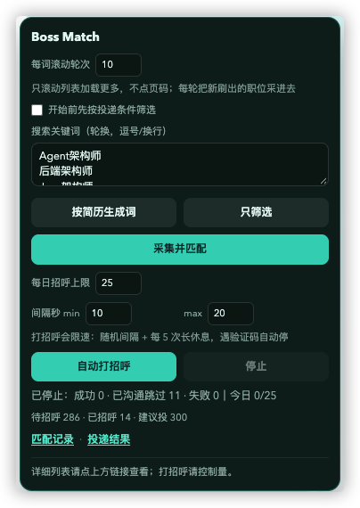
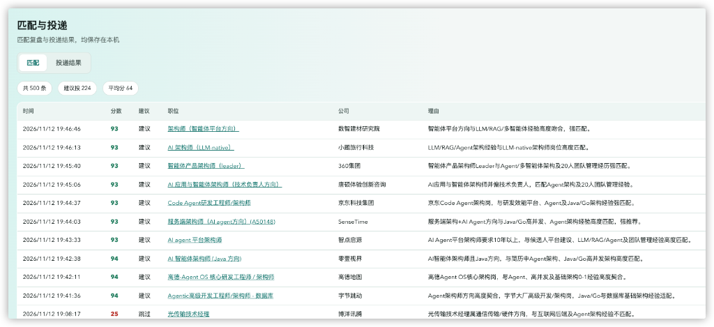

# Boss Match Helper

Chrome 扩展：在 [Boss 直聘](https://www.zhipin.com) 上按条件筛选、滚动采集职位列表，用 DeepSeek 批量匹配简历，并可选自动「打招呼」。

> 本地开源工具。请遵守 Boss 直聘用户协议与当地法规；控制自动招呼频率，自行承担使用风险。

## 功能

- **条件筛选**：根据自然语言投递条件映射/应用 Boss 筛选项
- **关键词轮换**：可从简历自动生成搜索词，多词依次采集
- **滚动采集**：慢速滚动加载职位卡片（不点页码）
- **批量匹配**：DeepSeek 批量打分，输出建议投 / 跳过
- **自动打招呼**：仅对「建议投」且未招呼过的职位，带每日上限与随机间隔
- **匹配与投递**：本地查看匹配记录、已招呼结果（面板内可直达）

## 界面预览

Boss 页右下角操作面板：



扩展配置弹窗：


匹配记录：



投递结果：


## 安装

1. 克隆本仓库  
   ```bash
   git clone https://github.com/zhaoyta/resumeposter.git
   ```
2. Chrome 打开 `chrome://extensions`
3. 开启「开发者模式」
4. 「加载已解压的扩展程序」→ 选择本仓库根目录
5. 改代码后：先刷新扩展，再**刷新 Boss 页面**

## 配置

点击扩展图标打开弹窗：

1. 填写 DeepSeek API 地址与 Key（默认 `https://api.deepseek.com`）
2. 填写投递条件、排除关键词、匹配阈值
3. 上传简历（`.docx` / `.txt` / `.md`）或粘贴文本
4. 建议「生成简历摘要」，并生成/填写搜索关键词
5. 保存配置

配置与匹配结果保存在浏览器本地 `chrome.storage`，不会上传到本项目服务器（本项目无后端）。

## 使用

在已登录的 Boss **职位列表页**，使用右下角面板：

1. （可选）勾选「开始前先按投递条件筛选」或点「只筛选」
2. 点 **采集并匹配**：按关键词搜索 → 滚动采集 → 批量打分
3. 查看统计后，点面板内 **匹配记录** / **投递结果** 看详情
4. （可选）**自动打招呼**：按额度与间隔执行，可随时停止

更多说明见 [`md/阶段1-使用说明.md`](md/阶段1-使用说明.md)。

## 目录结构

```
resumeposter/
├── manifest.json          # MV3 扩展清单
├── background/            # Service Worker（匹配、打招呼、存储）
├── content/               # Boss 页注入脚本与面板
├── popup/                 # 配置弹窗
├── history/               # 匹配与投递本地页
├── lib/                   # DeepSeek、存储、简历解析
├── assets/                # 图标与截图
└── md/                    # 文档
```

## 隐私与权限

- `storage`：保存配置与本地结果
- `tabs` / `scripting` / `activeTab`：打开临时职位页打招呼、注入脚本
- Host：`zhipin.com`、DeepSeek API 等

简历原文、API Key、匹配记录仅存于本机。请勿在 Issue / PR 中粘贴 Key 或简历内容。

## 开发说明

纯前端 Manifest V3 扩展，无构建步骤。本地改完后在 `chrome://extensions` 点刷新即可。

列表匹配主要使用卡片信息（标题、公司、标签等）以提升速度；完整 JD 需人工点开确认。

## License

[MIT](LICENSE)
