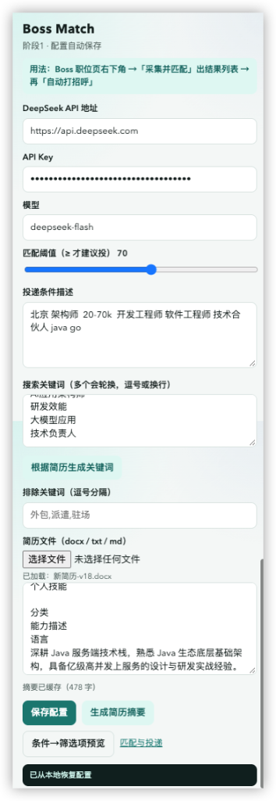
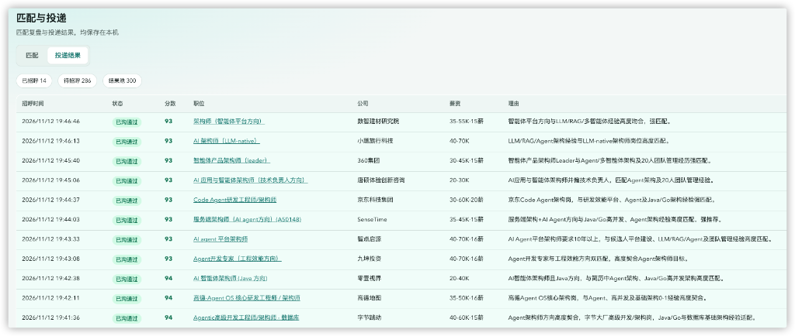

# Boss Match Helper

Chrome 扩展：在 [Boss 直聘](https://www.zhipin.com) 上按条件筛选、滚动采集职位列表，用 DeepSeek 批量匹配简历，并可选自动「打招呼」。

> 本地开源工具。请遵守 Boss 直聘用户协议与当地法规；控制自动招呼频率，自行承担使用风险。

## 功能

- **条件筛选**：根据自然语言投递条件映射/应用 Boss 筛选项
- **关键词轮换**：可从简历自动生成搜索词，多词依次采集
- **滚动采集**：慢速滚动加载职位卡片（不点页码）
- **批量匹配**：DeepSeek 批量打分，输出建议投 / 跳过
- **自动打招呼**：仅对「建议投」且未招呼过的职位，带每日上限与随机间隔
- **匹配与投递**：本地查看匹配记录、已招呼结果（面板内可直达）

## 界面预览

Boss 页右下角操作面板：


扩展配置弹窗：



匹配记录：


投递结果：



## 安装

1. 克隆本仓库  
   ```bash
   git clone https://github.com/zhaoyta/resumeposter.git
   ```
2. Chrome 打开 `chrome://extensions`
3. 开启「开发者模式」
4. 「加载已解压的扩展程序」→ 选择本仓库根目录
5. 改代码后：先刷新扩展，再**刷新 Boss 页面**

## 配置

配置分两处：**扩展弹窗**（点工具栏图标）与 **Boss 页右下角面板**。改动后多数会自动写入本地；弹窗也可点「保存配置」。数据在 `chrome.storage.local`，无项目后端。

### 扩展弹窗参数

| 参数 | 默认 | 作用与意义 |
| --- | --- | --- |
| **DeepSeek API 地址** | `https://api.deepseek.com` | 调用大模型的 API 根地址。一般用官方地址；自建/代理网关时改成你的 Base URL。 |
| **API Key** | 空 | DeepSeek 鉴权密钥（`sk-...`）。匹配、生成关键词、简历摘要都依赖它，不填无法跑模型。 |
| **模型** | `deepseek-flash` | 实际请求的模型名。更快更便宜可用 flash；要更高质量可改成官方提供的其它 chat 模型。 |
| **匹配阈值** | `70`（范围 40–95） | 分数 **≥ 该值** 才标为「建议投」。调高更严，调低更宽。**分数在采集匹配时已算好**；改阈值会立刻按本地分数重算建议投，不必重新采集。 |
| **投递条件描述** | 空 | 自然语言写城市、岗位、年限、薪资、不要外包等。用于：① 映射 Boss 筛选项；② 给模型打分时作偏好约束。写得越具体，筛选与匹配越稳。 |
| **搜索关键词** | 空 | 多个词用逗号或换行分隔。采集时**按词轮换**搜索并抓列表。可点「根据简历生成关键词」自动填；也可手改。面板里同名字段与这里同步。 |
| **排除关键词** | `外包,派遣,驻场` | 职位标题/公司/标签等命中任一词时，**不调模型**，直接低分并标「跳过」。用于硬过滤雷区。 |
| **简历文件 / 简历文本** | 空 | 上传 `.docx` / `.txt` / `.md`，或直接粘贴。是匹配打分的主要依据。 |
| **简历摘要** | 空 | 由「生成简历摘要」得到的压缩画像，发给模型时更省 token、更稳。建议配置好简历后点一次。 |

弹窗按钮：

| 按钮 | 作用 |
| --- | --- |
| **保存配置** | 立刻把弹窗里的项写入本地。 |
| **生成简历摘要** | 用模型从简历提炼摘要并保存。 |
| **根据简历生成关键词** | 根据简历/条件生成搜索词并写入「搜索关键词」。 |
| **条件→筛选项预览** | 预览投递条件会映射成哪些 Boss 筛选项（不立刻改页面）。 |
| **匹配与投递** | 打开本地页：Tab「匹配」看打分复盘，Tab「投递结果」看已招呼记录。 |

### Boss 面板参数

在已登录的 **职位列表页** 右下角打开面板：

| 参数 | 默认 | 作用与意义 |
| --- | --- | --- |
| **每词滚动轮次** | `10`（1–30） | 每个搜索关键词下，向下滚动加载列表的轮数。越大采得越多、越慢。只滚动加载，**不点页码**。 |
| **开始前先按投递条件筛选** | 开 | 点「采集并匹配」前，先按弹窗里的投递条件尝试套用 Boss 筛选项。关掉则跳过自动筛选，只用当前页面条件。 |
| **搜索关键词（轮换）** | 与弹窗同步 | 本轮采集用的词表；可留空，流程里会尝试按简历自动生成。 |
| **每日招呼上限** | `25`（1–500） | 自然日内允许成功打招呼的次数上限（按本机统计）。到顶后当天不再继续自动招呼。改数字后失焦/点招呼时会保存。 |
| **间隔秒 min / max** | `5` / `10` | 两次招呼之间的**随机等待**秒数，在 \[min, max\] 内取值。用于限速，降低风控概率。只有这一档间隔，没有额外「每 N 次长休息」。 |

面板按钮：

| 按钮 | 作用 |
| --- | --- |
| **按简历生成词** | 调用模型生成搜索关键词并填入面板（同时可写入配置）。 |
| **只筛选** | 只应用投递条件对应的 Boss 筛选，不采集、不匹配。 |
| **采集并匹配** | 关键词轮换搜索 → 滚动采集 → 批量打分；结果与已有池按职位去重合并，**保留已招呼标记**。 |
| **保存**（上限旁） | 单独写入每日招呼上限与间隔；额度满导致打招呼变灰时，抬高上限并保存后按钮应恢复可点。 |
| **自动打招呼** | 只对「建议投」且**尚未招呼**的职位执行；有待招呼且今日额度未满才可点；遇验证码/风控文案会停。 |
| **停止** | 中断当前采集或打招呼循环。 |
| **匹配记录 / 投递结果** | 打开本地详情页对应 Tab，无需再点扩展图标。 |

### 状态含义（简表）

| 状态 | 含义 |
| --- | --- |
| **库里** | 本地匹配库条数（与匹配记录同一数据源；不设条数上限，采多少留多少。旧版曾硬截 500，多采的当时已丢，需重新采集）。 |
| **建议投** | 分数 ≥ 匹配阈值，且未命中排除词（按匹配库统计，不是截断后的结果池）。 |
| **已投** | 本机已成功打招呼或检测到「继续沟通」类已沟通状态。 |
| **今日已投** | 今天已成功招呼次数（本机统计）。 |
| **上限** | 每日招呼上限；改完点「保存」生效。 |

## 使用

1. 按上文填好弹窗（API Key、简历、条件、阈值、关键词）
2. 打开 Boss **职位列表页**，用右下角面板
3. （可选）勾选筛选或点「只筛选」
4. 点 **采集并匹配**
5. 需要时点 **自动打招呼**，用「停止」随时打断
6. 详情看 **匹配记录** / **投递结果**

更多说明见 [`md/阶段1-使用说明.md`](md/阶段1-使用说明.md)。

## 目录结构

```
resumeposter/
├── manifest.json          # MV3 扩展清单
├── background/            # Service Worker（匹配、打招呼、存储）
├── content/               # Boss 页注入脚本与面板
├── popup/                 # 配置弹窗
├── history/               # 匹配与投递本地页
├── lib/                   # DeepSeek、存储、简历解析
├── assets/                # 图标与截图
└── md/                    # 文档
```

## 隐私与权限

- `storage`：保存配置与本地结果
- `tabs` / `scripting` / `activeTab`：打开临时职位页打招呼、注入脚本
- Host：`zhipin.com`、DeepSeek API 等

简历原文、API Key、匹配记录仅存于本机。请勿在 Issue / PR 中粘贴 Key 或简历内容。

## 开发说明

纯前端 Manifest V3 扩展，无构建步骤。本地改完后在 `chrome://extensions` 点刷新即可。

列表匹配主要使用卡片信息（标题、公司、标签等）以提升速度；完整 JD 需人工点开确认。

## License

[MIT](LICENSE)
